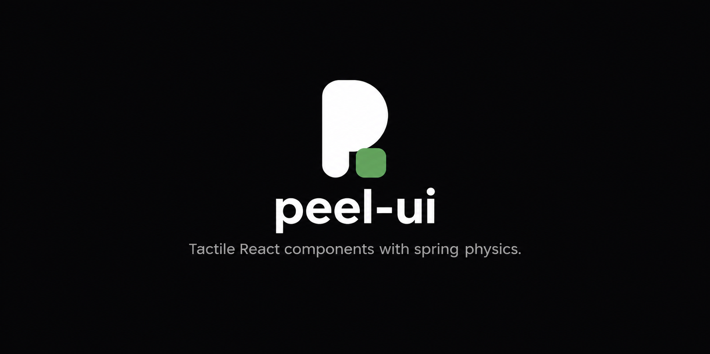

<div align="center">
  <a href="https://peel-ui.vercel.app">
    
  </a>
</div>

<br />

<div align="center">

**Tactile React primitives, built around deliberate 120fps motion.**

<a href="https://github.com/Killersumit/peel-ui">
  
</a>
<a href="https://peel-ui.vercel.app/llms.txt">
  
</a>
<a href="https://github.com/Killersumit/peel-ui/commits/main">
  
</a>
<a href="https://x.com/Sumit1476136">
  
</a>

<br />
<br />

[**peel-ui.vercel.app**](https://peel-ui.vercel.app) &nbsp;&middot;&nbsp; [Components](https://peel-ui.vercel.app/components) &nbsp;&middot;&nbsp; [Sponsors](https://peel-ui.vercel.app/sponsors) &nbsp;&middot;&nbsp; [Follow on X](https://x.com/Sumit1476136)

</div>

<br />

Peel UI is an open-source shadcn registry of React components that treat the screen like machined hardware: drag tracks with magnetic detents, critically damped springs instead of linear easing curves, and controls that settle instead of fade. Every component runs on the compositor thread, honors `prefers-reduced-motion`, and installs straight into your codebase. You own the code—no package to depend on.

## Quick start

Install any component directly with the shadcn CLI:

```bash
npx shadcn@latest add [https://peel-ui.vercel.app/r/slide-to-confirm.json](https://peel-ui.vercel.app/r/slide-to-confirm.json)

```

Or add the `@peel-ui` namespace once in your `components.json`:

```json
{
  "registries": {
    "@peel-ui": "[https://peel-ui.vercel.app/r/](https://peel-ui.vercel.app/r/){name}.json"
  }
}

```

Then install any primitive by name:

```bash
npx shadcn@latest add @peel-ui/slide-to-confirm

```

Browse all 22 interactive primitives with live workspace previews at [peel-ui.vercel.app/components](https://peel-ui.vercel.app/components).

## MCP & AI Agents (Claude Code, Cursor, Windsurf, OpenCode)

1. **Zero-Config (`llms.txt`):** Point your AI coding agent to [`https://peel-ui.vercel.app/llms.txt`](https://peel-ui.vercel.app/llms.txt) or click **Copy .md for LLMs** on any component workspace page.
2. **shadcn MCP:** With `@peel-ui` added to your `components.json` above, initialize the MCP server:

```bash
npx shadcn@latest mcp init --client claude
# or: --client cursor | vscode

```

Then prompt your agent: `add @peel-ui/shortcut-teacher` or `add @peel-ui/morphing-share-island`.

## Selected components

| Component | Install slug | Interaction |
| --- | --- | --- |
| Shortcut Teacher | `shortcut-teacher` | Silent pointer counter that reveals an anchored keycap hint after repeated mouse clicks |
| Morphing Share Island | `morphing-share-island` | Compact share pill that spring-morphs into a 4-action radial dock |
| Slide to Confirm | `slide-to-confirm` | Friction drag track with a magnetic confirmation threshold |
| Magnetic Split Button | `magnetic-split-button` | Primary and secondary actions that pull apart on a spring latch |
| Tactile OTP Input | `tactile-otp-input` | Numeric pin field with a spring-driven floating focus frame |
| Privacy Shutter | `privacy-shutter` | Drag-to-peek mechanical cover for sensitive values |
| Voice Pill | `voice-pill` | Audio capture pill with live waveform and slide-to-cancel |
| Save State Pill | `save-state-pill` | Save, offline, retry, and conflict states in one morphing island |
| Tactile Filter Chips | `filter-chips` | Single or multi-select chips that reflow on a spring |
| Note Button | `note-button` | Action button that morphs into a persistent local scratchpad |
| Roadmap Vote (`Next Up`) | `roadmap-vote` | Interactive upvote ledger with spring-animated rank reordering |
| Invite Field | `invite-field` | Tokenized email chip input with GSAP Flip layout transitions |

See the full catalog at [peel-ui.vercel.app/components](https://peel-ui.vercel.app/components).

## Sponsors

Peel UI is 100% free and open-source. Monthly sponsorships directly support the creator and keep every component free without paywalls.

See available **Diamond**, **Gold**, and **Silver** tiers at [peel-ui.vercel.app/sponsors](https://peel-ui.vercel.app/sponsors), or reach out directly on [X (@Sumit1476136)](https://x.com/Sumit1476136) or via email at [`killer1191x@gmail.com`](https://www.google.com/search?q=mailto%3Akiller1191x%40gmail.com).

## Running locally

```bash
git clone [https://github.com/Killersumit/peel-ui.git](https://github.com/Killersumit/peel-ui.git)
cd peel-ui
npm install
npm run dev

```

primitives live in `src/registry/primitives/`. After editing a component or `src/registry/index.ts`, rebuild the static registry payloads with:

```bash
npm run build

```

## Contributing & Community

Please read our [Contributing Guide](CONTRIBUTING.md), [Code of Conduct](CODE_OF_CONDUCT.md), and [Security Policy](SECURITY.md) before opening an Issue or Pull Request.

## License

Released under the [MIT License](https://www.google.com/search?q=LICENSE). You are free to use, modify, and ship these components in personal, client, and commercial applications without attribution requirements. The Peel UI name, logo mark, and website design may not be cloned as a competing component registry.